# Kindle-Dashboard

Ein alter Kindle als Info-Bildschirm für den Eingang: Wetter, Termine, Abfahrten, Entsorgung, die Bring!-Einkaufsliste und Aufgaben auf einen Blick, bedienbar per Touch.

<p>
  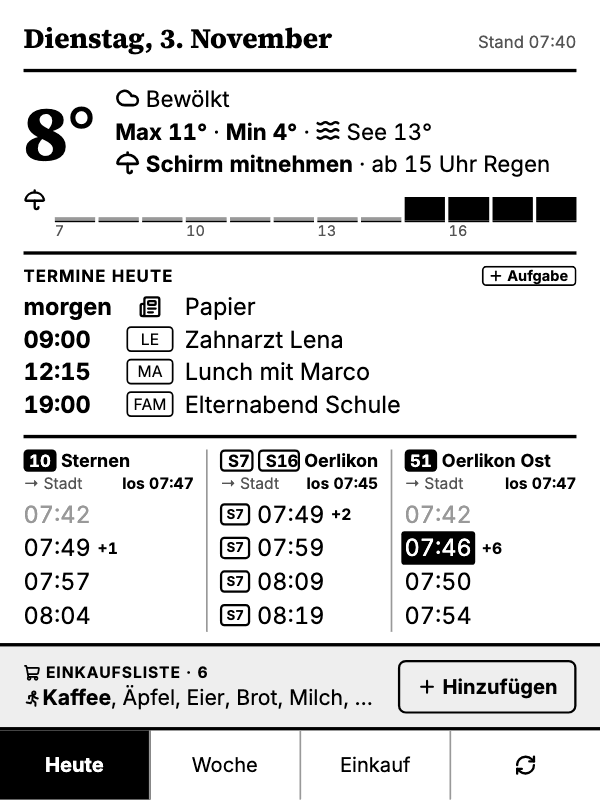
  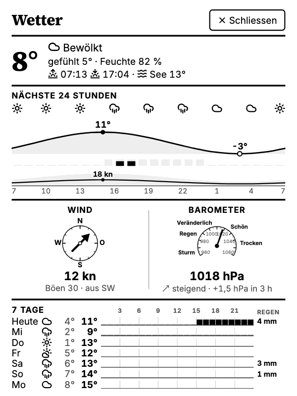
  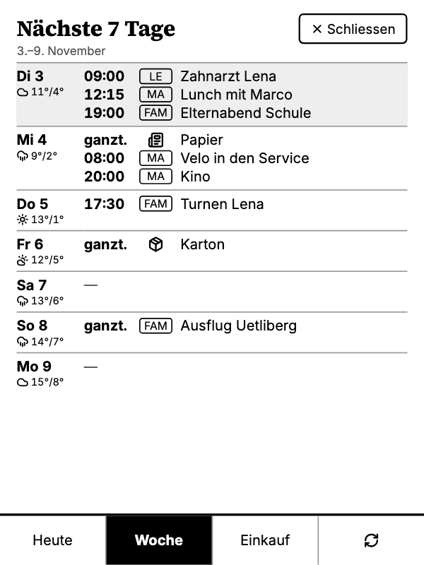
</p>

## Inhalt

- [Was es kann](#was-es-kann)
- [Wie es funktioniert](#wie-es-funktioniert)
- [Server einrichten](#server-einrichten)
- [Kindle einrichten](#kindle-einrichten)
- [Bedienung](#bedienung)
- [Vorschau im Browser](#vorschau-im-browser)
- [Fehlersuche](#fehlersuche)
- [Sicherheit](#sicherheit)
- [Entwicklung](#entwicklung)
- [Datenquellen](#datenquellen)
- [Architektur](#architektur)

## Was es kann

| Ansicht | Inhalt |
|---|---|
| **Heute** | Datum, Wetter (aktuell, Max/Min, Zürichsee-Temperatur, Regenhinweis und 12-Stunden-Regenband), Termine des Tages inkl. Papier- und Kartonsammlung, Abfahrten an drei Haltestellen Richtung Stadt, Bring!-Liste mit dem zuletzt erfassten Artikel zuerst. An Geburtstagen gross «Happy Birthday …!» mit Kuchen über den Terminen. Offene Aufgaben (Bring!-Liste «Aufgaben») in einer schwarzen Box über den Terminen, daneben «+ Aufgabe». Ab 19 Uhr: verbleibende Termine des Abends, die Termine von morgen und das Wetter von morgen. |
| **Wetter** | Gefühlte Temperatur, Feuchtigkeit, Sonnenauf- und -untergang, Seetemperatur; 24-Stunden-Grafik mit Wettersymbolen, Temperaturkurve, Regen und Wind; Windrose (Knoten), Barometer mit Tendenz; 7 Tage mit Min/Max und wann es regnet. |
| **Haltestelle** | Pro Haltestelle die nächsten 8 Abfahrten in beide Richtungen mit tatsächlicher Endhaltestelle. |
| **Woche** | Die nächsten 7 Tage ab heute mit Terminen, Entsorgung und Wetter. Im Gast-Modus wie «Heute» mit geschwärzten Titeln. |
| **Einkauf** | Die Bring!-Liste; Antippen hakt einen Artikel ab, mit «Rückgängig». Der rennende Mann rechts auf der Kachel setzt «Dringend»; dringende Artikel stehen zuerst und schwarz, auch im Widget in «Heute». 10 Artikel pro Seite, unten «‹ Zurück · Seite 1 von 3 · Weiter ›». |
| **Hinzufügen** | Artikel per Bildschirmtastatur, Vorschlägen oder 15 «Oft gekauft»-Kacheln erfassen. Im Reiter «Aufgabe» Aufgaben erfassen, mit «Häufig»-Kacheln. |

<p>
  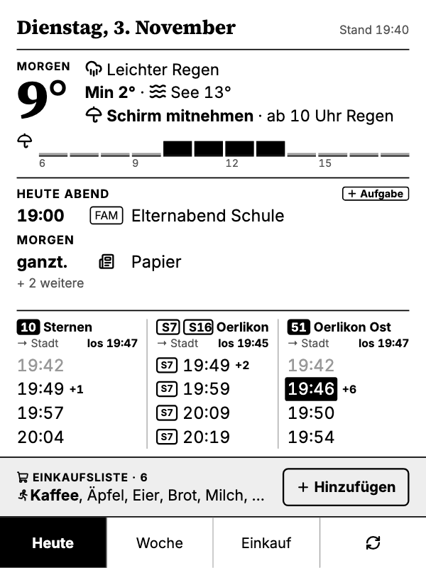
  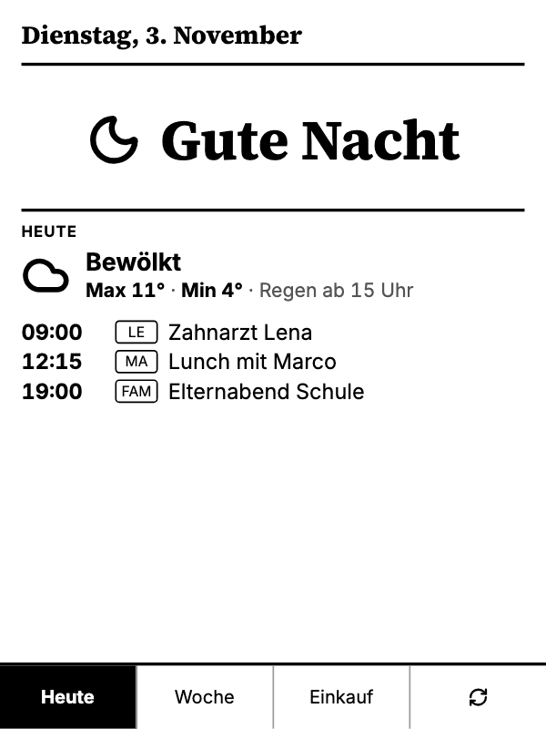
  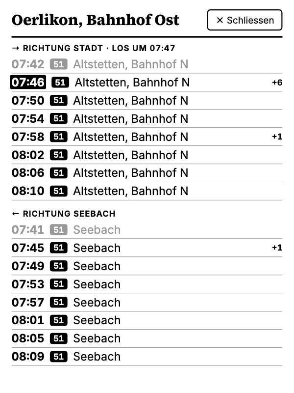
  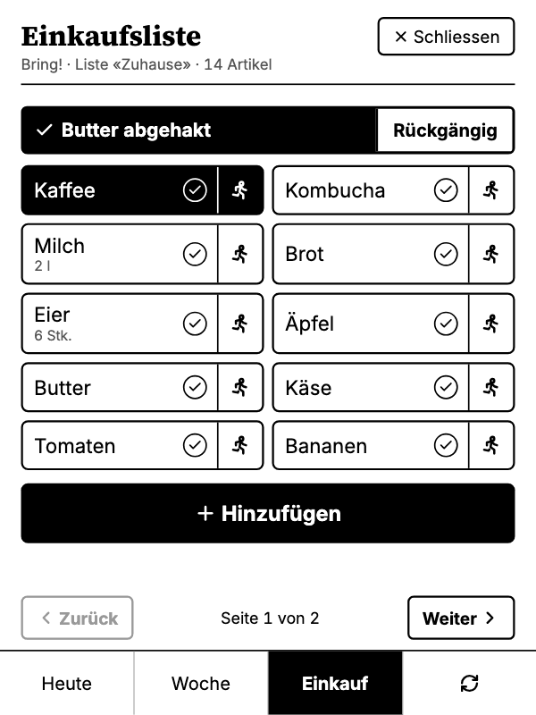
  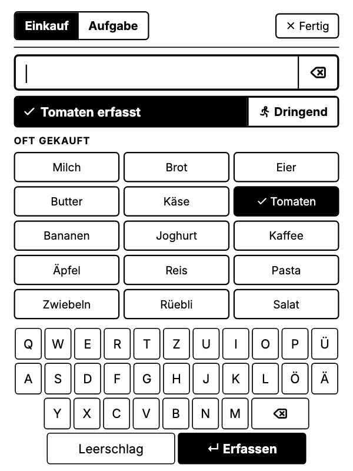
</p>

Verspätungen ab 5 Minuten werden schwarz hinterlegt. Abfahrten, die man zu Fuss nicht mehr erreicht, sind grau; über jeder Haltestelle steht, wann man losgehen muss («los 07:45»). In der Nachtruhe (Standard 00:00–05:30) zeigt das Dashboard einen ruhigen Nachtbildschirm mit dem Wichtigsten des kommenden Tages. Ohne Bedienung kehrt das Dashboard nach 2 Minuten zu «Heute» zurück. Fällt der Akku auf 20 % oder weniger und hängt der Kindle nicht am Strom, steht oben rechts in «Heute» und auf dem Nachtbildschirm ein leerer Akku mit dem Ladestand.

**Gast-Modus:** Wenn Besuch da ist, sind alle Termintitel schwarz überdeckt; Uhrzeit, Kalenderkürzel und Papier-/Kartonsammlung bleiben stehen, ein Schloss neben dem Titel zeigt den Modus an. Er schaltet sich selbst ein, solange ein Termin läuft, dessen Titel mit «Besuch» beginnt (z. B. «Besuch Müllers» 18–23 Uhr) – dieser Termin selbst bleibt lesbar. Von Hand: siehe [Bedienung](#bedienung).

**Geburtstage** (`BIRTHDAYS`) grüsst «Heute» den ganzen Tag gross über den Terminen mit «Happy Birthday …!» und einem Kuchen, ebenso der Nachtbildschirm, wenn er diesen Tag zeigt (mit der Standard-Nachtruhe also von 00:00 bis 05:30 am Geburtstag).

<p>
  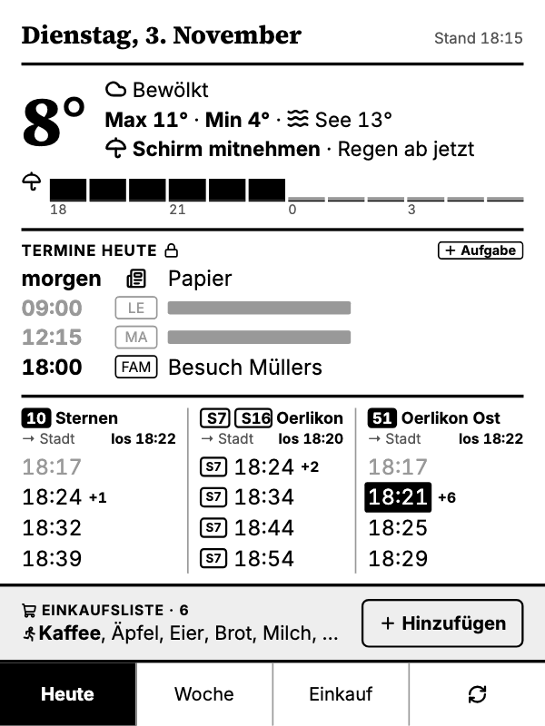
  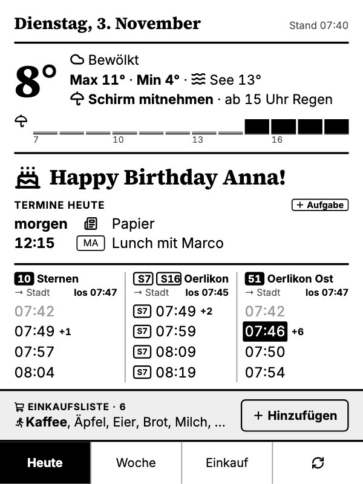
  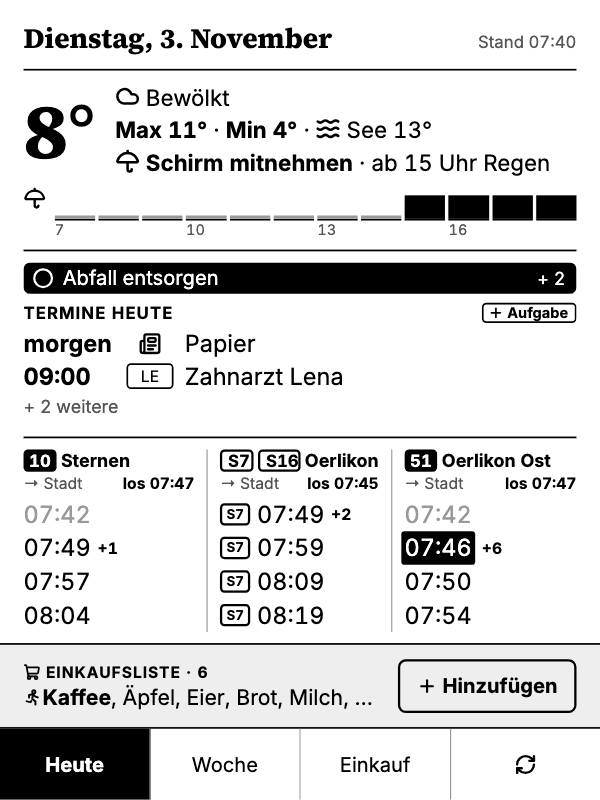
  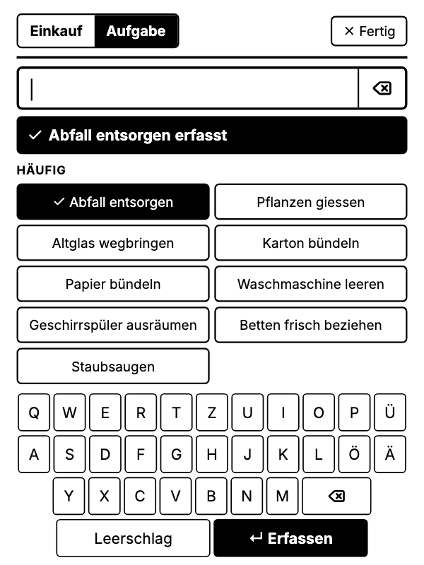
</p>

## Wie es funktioniert

```
 ┌──────────── Kindle ────────────┐          ┌──────────── Server (Coolify) ────────────┐
 │ dashboard (Go, ARMv7)          │  HTTPS   │ Node/TypeScript, Fastify                  │
 │  · holt alle 2 Min. ein PNG    │ ───────▶ │  · sammelt Daten aus den Quellen          │
 │  · zeigt es mit FBInk an       │          │  · rendert HTML mit Chromium zu einem     │
 │  · schickt Taps (x, y)         │ ◀─────── │    600×800-PNG in 16 Graustufen           │
 └────────────────────────────────┘          │  · merkt sich Ansicht und Tap-Bereiche    │
                                             └───────────────────────────────────────────┘
```

Der Kindle ist ein «dummer» Bildschirm: Er zeigt nur Bilder an und meldet, wo getippt wurde. Alles andere – Daten holen, Layout, Logik – passiert auf dem Server. Neue Funktionen brauchen darum fast nie ein Update auf dem Kindle. Ausführlich beschrieben in der [Architekturdokumentation (arc42)](docs/architektur/arc42.md).

```
client/   Kindle-Programm (Go) und Startskripte
server/   Render-Server (TypeScript)
docs/     Spezifikation, Pläne, Bildschirmfotos
```

## Server einrichten

Der Server läuft als Docker-Container, z. B. in [Coolify](https://coolify.io).

1. Neue Ressource → *Application* → dieses Git-Repository.
2. Build Pack **Dockerfile**, Base Directory `/server`, Port `3000`.
3. Domain setzen, z. B. `https://kindle.example.ch` (das Zertifikat holt Coolify selbst).
4. Healthcheck-Pfad: `/healthz`.
5. Umgebungsvariablen eintragen (siehe unten). Geheime Werte als *Secret* markieren.
6. Für automatische Deployments: In GitHub unter *Settings → Webhooks* den Webhook von Coolify eintragen.

### Umgebungsvariablen

| Variable | Pflicht | Bedeutung |
|---|---|---|
| `DEVICE_TOKEN` | ja | Schlüssel des Kindle. Erzeugen mit `openssl rand -base64 32 \| tr '+/' '-_' \| tr -d '='` |
| `PREVIEW_PASSWORD` | ja | Passwort für die Browser-Vorschau (Benutzer `admin`) |
| `CALENDARS` | | Kalender als JSON: `[{"label":"PF","url":"<geheime iCal-Adresse>"},{"label":"FAM","url":"…"}]`. Das Kürzel erscheint vor jedem Termin. |
| `BRING_EMAIL`, `BRING_PASSWORD` | | Bring!-Konto; ohne diese Angaben bleibt die Einkaufsliste leer |
| `BRING_LIST` | | Name der Liste, Standard `Zuhause` |
| `BRING_LOCALE` | | Sprache der Artikelnamen, Standard `de-CH` |
| `BRING_TASKS_LIST` | | Bring!-Liste für Aufgaben, Standard `Aufgaben`; leer = keine Aufgaben. Die Liste in der Bring!-App anlegen und mit der Familie teilen; dort lassen sich Aufgaben auch erfassen und abhaken. |
| `STATIONS` | | Haltestellen als JSON, siehe unten |
| `BIRTHDAYS` | | Geburtstage als JSON, Datum `MM-TT`: `[{"name":"Anna","date":"12-01"}]`. Am Tag steht in «Heute» und auf dem Nachtbildschirm gross «Happy Birthday Anna!» mit Kuchen. Standard: keine |
| `WEATHER_LAT`, `WEATHER_LON` | | Ort für Wetter, Standard Zürich-Oerlikon (`47.411`, `8.544`) |
| `WASTE_ZIP` | | Postleitzahl für Papier- und Kartonsammlung der Stadt Zürich, Standard `8050`; leer = aus |
| `QUIET_HOURS` | | Nachtruhe mit Nachtbildschirm und ohne Aktualisierung, Standard `00:00-05:30`; leer = aus |
| `NTFY_TOPIC` | | Push-Benachrichtigung über [ntfy](https://ntfy.sh), wenn der Kindle sich nicht mehr meldet oder der Akku fast leer ist: ein schwer erratbarer Name, z. B. `kindle-` + 12 zufällige Zeichen |
| `NTFY_SERVER` | | ntfy-Server, Standard `https://ntfy.sh` |
| `OFFLINE_ALERT_MINUTES` | | Toleranz nach der erwarteten nächsten Abfrage, Standard `15` |
| `REFRESH_SECONDS` | | Abstand der Aktualisierung, Standard `120` |
| `VIEW_RESET_SECONDS` | | Zurück zu «Heute» nach so vielen Sekunden ohne Bedienung, Standard `120` |

**Geheime iCal-Adresse (Google):** Kalender-Einstellungen → Kalender auswählen → «Kalender integrieren» → «Geheime Adresse im iCal-Format». Diese Adresse gibt vollen Lesezugriff – nur in Coolify eintragen, nirgends sonst.

**Haltestellen:** `id` ist die Haltestellennummer (DIDOK, z. B. aus [transport.opendata.ch](https://transport.opendata.ch)), `via` eine Haltestelle, die nur Fahrten Richtung Stadt passieren, `lines` die angezeigten Linien, `walk` der Fussweg von der Haustür in Minuten:

```json
[
  { "id": "8591382", "name": "Sternen", "via": "Zürich, Milchbuck", "lines": ["10"], "walk": 3 },
  { "id": "8503006", "name": "Oerlikon", "via": "Zürich HB", "lines": ["S7", "S16"], "walk": 6 },
  { "id": "8591063", "name": "Oerlikon Ost", "via": "Zürich, Milchbuck", "lines": ["51"], "walk": 5 }
]
```

### Benachrichtigung bei Ausfall und leerem Akku (optional)

1. Die App **ntfy** installieren (iOS/Android) und ein Thema mit einem schwer erratbaren Namen abonnieren, z. B. `kindle-x7Gq2pLm9vRt` (`openssl rand -hex 6` liefert Zufallszeichen).
2. Denselben Namen in Coolify als `NTFY_TOPIC` eintragen und neu deployen.

Der Server kennt nach jedem Bild den Zeitpunkt der nächsten Abfrage (in der Nachtruhe Stunden später). Bleibt sie länger als `OFFLINE_ALERT_MINUTES` aus, kommt «Kindle meldet sich nicht», nach der Rückkehr «Kindle wieder online».

Der Kindle schickt bei jeder Abfrage seinen Ladestand mit. Sinkt er auf 20 % oder weniger, ohne dass er lädt, kommt einmal «Kindle-Akku fast leer»; erneut erst, nachdem er geladen hat (oder wieder über 25 % liegt). Das braucht den Kindle-Client ab 2026-11-06.

### Prüfen

```bash
curl -s https://kindle.example.ch/healthz          # → ok
curl -s -o /dev/null -w '%{http_code}\n' https://kindle.example.ch/screen.png   # → 401 ohne Token
```

## Kindle einrichten

### Voraussetzungen

- Ein Kindle mit Jailbreak und Zugriff auf Skripte aus der Bibliothek (hier: Kindle 7. Generation, WP63GW, 600 × 800, Firmware 5.12.2.2, WinterBreak2 mit KMC).
- FBInk auf dem Gerät (`/var/local/kmc/bin/fbink` oder `/mnt/us/libkh/bin/fbink`).
- Docker auf dem Computer, auf dem gebaut wird (Go muss nicht installiert sein).

### Bauen

```bash
cd client
make test    # Tests
make dist    # baut ../dist/kindle/ für ARMv7
```

### Installieren

1. Kindle per USB anschliessen.
2. Kopieren:
   - `dist/kindle/dashboard/` → `Kindle/dashboard/`
   - `dist/kindle/documents/Dashboard.sh` → `Kindle/documents/` (optional auch `Dashboard-Diagnose.sh`, `Dashboard-Systeminfo.sh`)
3. `Kindle/dashboard/config.example.json` nach `config.json` kopieren und anpassen:

```json
{
  "serverUrl": "https://kindle.example.ch",
  "token": "<DEVICE_TOKEN aus Coolify>",
  "touch": { "deviceName": "zforce2", "swapXY": false, "invertX": false, "invertY": false },
  "powerDeviceName": "max77696-onkey",
  "powerKeyCode": 116
}
```

Optional: `screenWidth`/`screenHeight` (Standard 600 × 800). Das Token gehört nur in diese Datei auf dem Kindle, nicht ins Repository.

4. Kindle auswerfen, abziehen und in der Bibliothek **Dashboard** antippen.

### Aktualisieren

Nur nötig, wenn sich das Kindle-Programm ändert (zuletzt für das lange Drücken im Gast-Modus); neue Ansichten kommen allein über den Server. Mit `make dist` bauen, Kindle per USB anschliessen, `dist/kindle/dashboard/dashboard` nach `Kindle/dashboard/` kopieren und die alte Datei ersetzen. `config.json` bleibt unverändert. Den Server vorher deployen: Ein älterer Server versteht das lange Drücken nicht und behandelt es wie ein Tippen.

## Bedienung

| Aktion | Wirkung |
|---|---|
| Tab unten antippen | Heute, Woche, Einkauf; **⟳** lädt alle Daten neu (der Bildschirm blinkt einmal als Bestätigung) |
| Wetterbereich antippen | Wetter-Detailansicht |
| Abfahrtsspalte antippen | Haltestelle mit beiden Richtungen |
| Einkaufsliste unten in «Heute» antippen | Einkauf («+ Hinzufügen» daneben öffnet weiterhin Hinzufügen) |
| Terminbereich antippen | Woche |
| **Terminbereich lange drücken** (über 1,2 Sekunden) | Gast-Modus umschalten (der Bildschirm blinkt einmal). Ein: bis der gerade laufende Termin vorbei ist, läuft keiner, bis zum nächsten langen Drücken. Während eines «Besuch»-Termins: aus bis zu dessen Ende. |
| «Schliessen» oben rechts | zurück zu Heute |
| Einkaufsartikel antippen | in Bring! abhaken; «Rückgängig» setzt ihn zurück |
| Rennender Mann rechts auf der Kachel | «Dringend» in Bring! ein/aus (wie in der App) |
| «Zurück» / «Weiter» unten in «Einkauf» | blättern; beim Öffnen beginnt «Einkauf» auf Seite 1 |
| **🏃 Dringend** in der Meldung nach dem Erfassen | den eben erfassten Artikel auf dringend setzen; auch bei «steht schon auf der Liste», so erreicht man Artikel, die in «Einkauf» nicht mehr Platz haben |
| Aufgabe in der Box antippen | in Bring! erledigt, ohne «Rückgängig»; die nächste offene rückt nach |
| **+ Aufgabe** neben «Termine heute» | «Hinzufügen» im Reiter «Aufgabe»; oben zwischen «Einkauf» und «Aufgabe» wechseln |
| **Ecke oben links 5 Sekunden halten** oder **Ein/Aus-Taste kurz drücken** | Dashboard beenden, die normale Kindle-Oberfläche kommt zurück |

Während das Dashboard läuft, ist die Kindle-Oberfläche nur angehalten, nicht beendet. Beim Beenden ist die Bibliothek darum nach ein, zwei Sekunden wieder da. Ohne Netz bleibt das letzte Bild stehen, unten rechts erscheint «offline seit HH:MM».

## Vorschau im Browser

`https://kindle.example.ch/preview` (Benutzer `admin`, Passwort `PREVIEW_PASSWORD`) listet alle Ansichten – als Webseite und als PNG genau so, wie es der Kindle bekommt. Darunter auch «Heute am Abend» und «Heute in der Nacht», um Abendmodus und Nachtbildschirm tagsüber zu sehen, «Heute/Woche mit Gästen» für den Gast-Modus, und jede Haltestelle. Die Vorschau zeigt echte Daten und verändert den Zustand des Kindle nicht.

## Fehlersuche

| Problem | Lösung |
|---|---|
| Dashboard startet nicht | `Kindle/dashboard/client.log` und `crash.log` ansehen (Kindle per USB anschliessen). Fehlt `config.json`, steht das dort. |
| «Token ungültig» unten rechts | `token` in `config.json` stimmt nicht mit `DEVICE_TOKEN` in Coolify überein. |
| «offline seit …» | WLAN des Kindle oder Server prüfen; das Dashboard versucht es selbst wieder. |
| Kindle reagiert nicht mehr | Ein/Aus-Taste ca. 15 Sekunden halten: Neustart, danach läuft der Kindle normal. |
| Touch-Werte prüfen | Skript **Dashboard-Diagnose** in der Bibliothek antippen; Ergebnis in `Kindle/dashboard/diag.txt`. |
| Systemprotokoll ansehen | Skript **Dashboard-Systeminfo** (nur lesend); Ergebnis in `Kindle/dashboard/sysinfo.txt` und `logs/`. |
| Vorschau antwortet mit 429 | Nach 20 falschen Passwörtern ist die Vorschau 15 Minuten gesperrt; abwarten. Der Kindle ist davon nicht betroffen. |
| Deployment schlägt fehl | Coolify-Log ansehen; bei «Permission denied (publickey)» oder Zeitüberschreitung zu GitHub hilft meist ein erneuter Deploy. |

Gerätedetails und Erkenntnisse vom Testen stehen in [`client/DEVICE_FACTS.md`](client/DEVICE_FACTS.md).

## Sicherheit

- **Zugang:** Der Kindle meldet sich mit einem zufälligen 256-Bit-Token, die Vorschau mit Benutzer `admin` und Passwort; beides wird in konstanter Zeit verglichen. Nach 20 falschen Vorschau-Passwörtern sperrt der Server die Vorschau für 15 Minuten.
- **Geheimnisse** (Token, Passwort, iCal-Adressen, Bring!-Zugang, ntfy-Thema) stehen nur in Coolify bzw. in `config.json` auf dem Kindle – nie im Repository und nie in Logs. In Coolify bei diesen Variablen **keinen** Haken bei «Build Variable» setzen.
- **Transport:** HTTPS mit Let's Encrypt, HSTS; der Kindle prüft Zertifikate mit eigener CA-Liste und mindestens TLS 1.2.
- **Server:** Container ohne root-Rechte; Taps werden geprüft; gerenderte Seiten haben keinen Netzzugriff; Sicherheitsheader und für die Vorschau eine strenge Content-Security-Policy, kein Caching.
- **Kindle verloren?** In Coolify ein neues `DEVICE_TOKEN` setzen – das alte ist sofort wertlos.

## Entwicklung

### Server

```bash
cd server
npm install
npx playwright install chromium
DEVICE_TOKEN=dev PREVIEW_PASSWORD=dev npm run dev   # http://localhost:3000/preview
npm test            # Vitest, rund 300 Tests
npm run typecheck
npm run screenshots # Bilder in docs/screenshots aus Beispieldaten neu erzeugen
```

Wichtige Stellen:

| Datei | Inhalt |
|---|---|
| `src/dashboard.ts` | Zustand, Taps, welche Daten in welche Ansicht kommen |
| `src/state.ts` | Ansichten, Aktionen, Navigation |
| `src/sources/` | Datenquellen (Wetter, Kalender, ÖV, Bring!, See, Entsorgung) |
| `src/views/` | Ansichten als Preact-Komponenten, `styles.ts` für das CSS |
| `src/render/` | Chromium-Rendering auf 600 × 800, Graustufen |

Das Layout ist in 1072 × 1429 CSS-Pixeln gestaltet und wird beim Rendern auf 600 × 800 verkleinert; Schrift wird dabei direkt in Zielgrösse gezeichnet.

### Kindle-Programm

Go 1.23, gebaut und getestet in Docker (`make test`, `make build`). Ein statisches Binary mit eingebauten Zertifikaten und Zeitzonendaten, keine Abhängigkeiten auf dem Gerät ausser FBInk.

## Datenquellen

| Daten | Quelle |
|---|---|
| Wetter | [Open-Meteo](https://open-meteo.com) (MeteoSchweiz ICON-CH2, sonst Best Match) |
| Zürichsee-Temperatur | [Alplakes](https://www.alplakes.eawag.ch) (Eawag) |
| Abfahrten | [transport.opendata.ch](https://transport.opendata.ch) |
| Papier- und Kartonsammlung | [OpenERZ](https://openerz.metaodi.ch) (Entsorgung + Recycling Zürich) |
| Einkaufsliste | Bring! (inoffizielle API der Apps, wie [bring-api](https://github.com/miaucl/bring-api)) |
| Termine | iCal-Adressen der Kalender |
| Symbole | [Lucide](https://lucide.dev); rennender Mann aus [Tabler Icons](https://tabler.io/icons) (MIT) |

## Architektur

Die Architektur ist nach [arc42](https://arc42.org) dokumentiert: [`docs/architektur/arc42.md`](docs/architektur/arc42.md) – Ziele und Randbedingungen, Kontext, Bausteine von Kindle-Programm und Server, Abläufe (Aktualisierung, Tap, Start und Beenden, Offline), Verteilung, Konzepte wie Rendering und E-Ink-Bildwechsel, Architekturentscheidungen sowie Risiken.

## Lizenz

[MIT](LICENSE). Symbole von Lucide (ISC) und Tabler Icons (MIT), Emoji für die Demo-Animation aus Fluent Emoji (MIT, siehe `server/scripts/assets/`).
