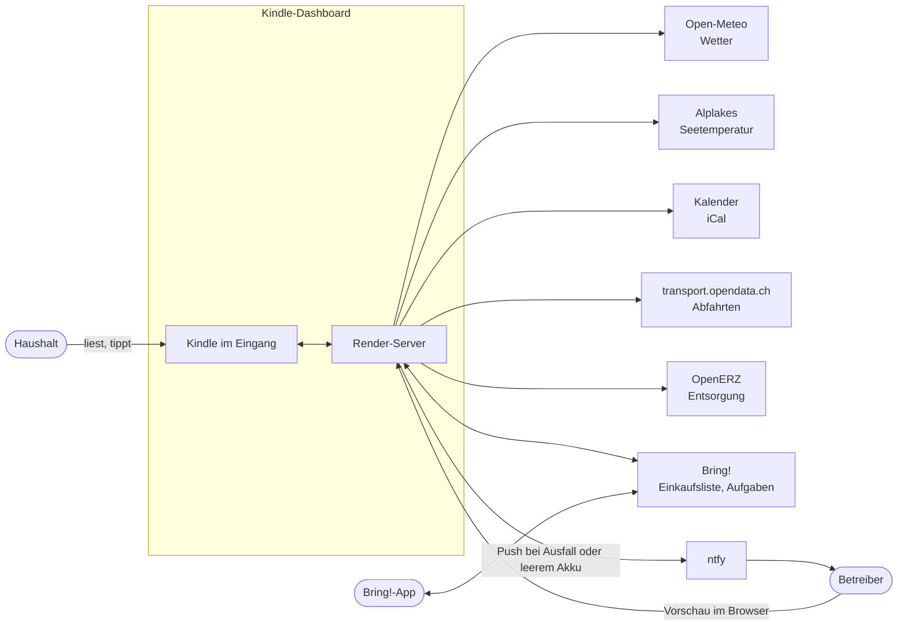
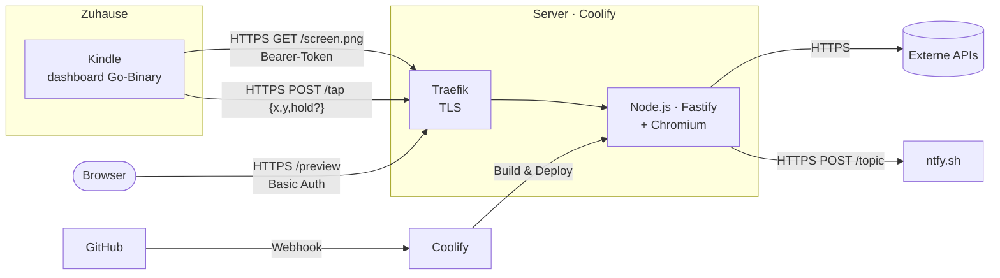
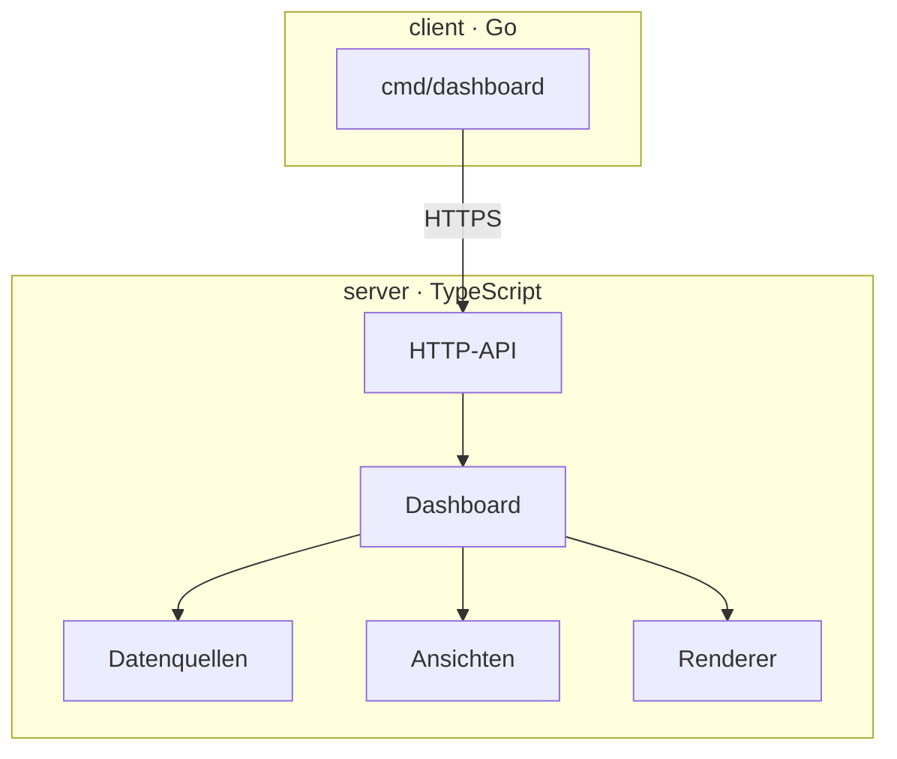
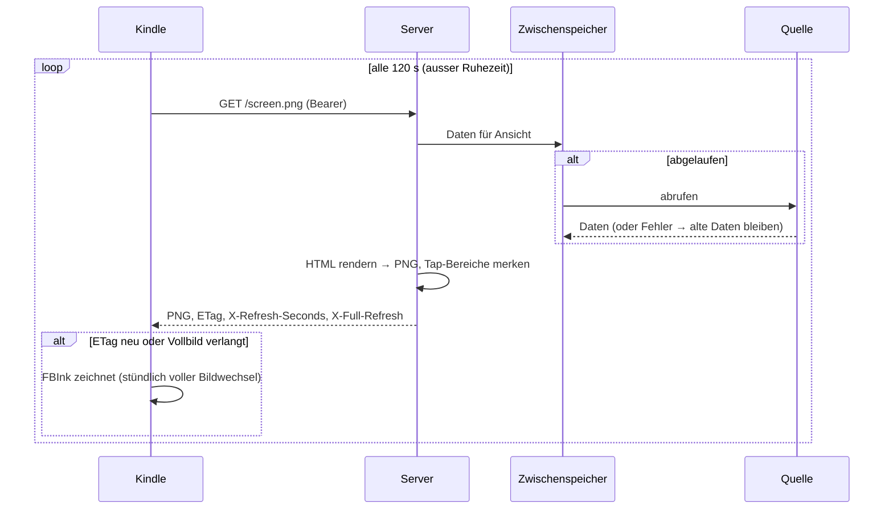
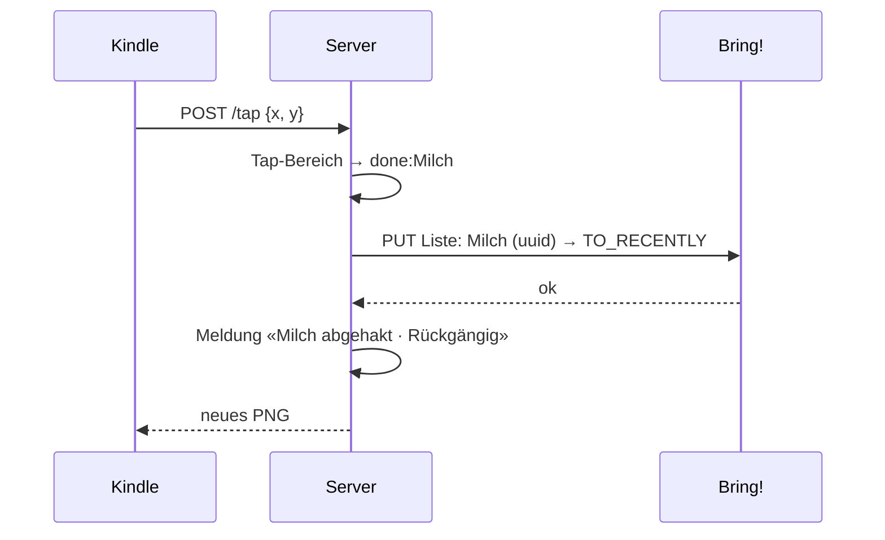
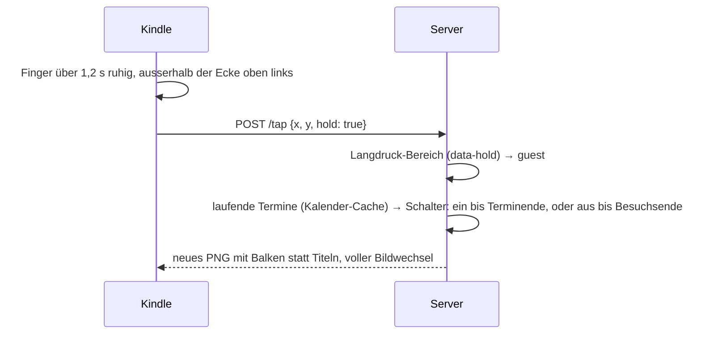
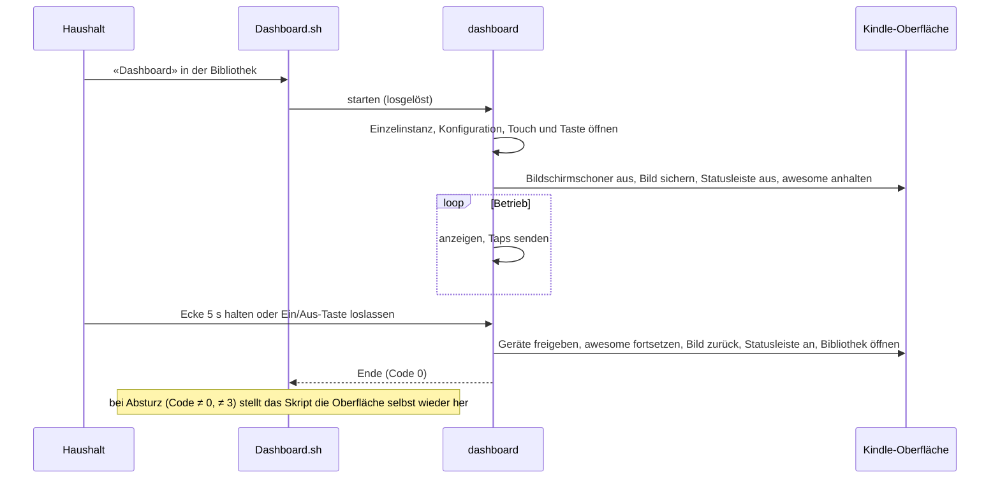
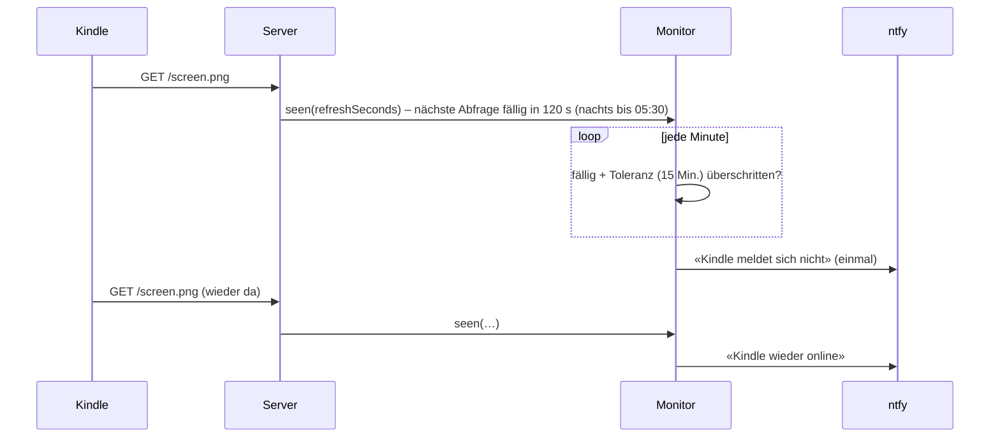
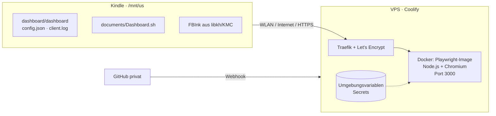
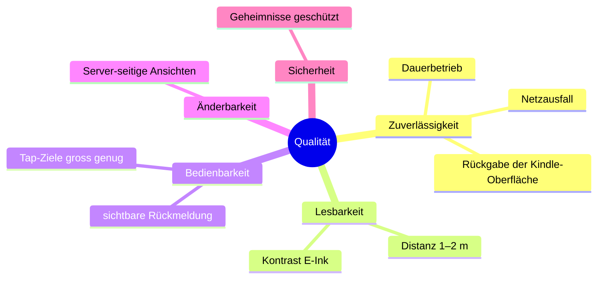

# Kindle-Dashboard – Architekturdokumentation (arc42)

Stand: 4. November 2026, abends · Vorlage: [arc42](https://arc42.org), Version 8

## Inhalt

1. [Einführung und Ziele](#1-einführung-und-ziele)
2. [Randbedingungen](#2-randbedingungen)
3. [Kontextabgrenzung](#3-kontextabgrenzung)
4. [Lösungsstrategie](#4-lösungsstrategie)
5. [Bausteinsicht](#5-bausteinsicht)
6. [Laufzeitsicht](#6-laufzeitsicht)
7. [Verteilungssicht](#7-verteilungssicht)
8. [Querschnittliche Konzepte](#8-querschnittliche-konzepte)
9. [Architekturentscheidungen](#9-architekturentscheidungen)
10. [Qualitätsanforderungen](#10-qualitätsanforderungen)
11. [Risiken und technische Schulden](#11-risiken-und-technische-schulden)
12. [Glossar](#12-glossar)

---

## 1. Einführung und Ziele

### 1.1 Aufgabenstellung

Ein ausgedienter E-Reader (Kindle 7. Generation) hängt im Eingang und zeigt auf einen Blick, was man beim Verlassen der Wohnung wissen will:

- Wetter jetzt und heute (inkl. Zürichsee-Temperatur, Regen nach Stunden), ausführlich mit Wind, Barometer und 7-Tage-Übersicht
- Termine aus mehreren Kalendern, dazu Papier- und Kartonsammlung; Gast-Modus, der die Titel schwärzt, wenn Besuch da ist; Geburtstagsgruss
- Abfahrten an drei Haltestellen, im Detail in beide Richtungen mit Endhaltestelle
- die Bring!-Einkaufsliste: ansehen (seitenweise), abhaken, als dringend markieren, Artikel erfassen
- Aufgaben aus einer zweiten Bring!-Liste: am Kindle und am Handy erfassen, mit einem Tipp erledigen

Ab 19 Uhr rückt der folgende Tag in den Vordergrund, in der Nachtruhe (00:00–05:30) zeigt ein ruhiger Nachtbildschirm das Wichtigste des kommenden Tages. Bei den Abfahrten berücksichtigt das Dashboard den Fussweg zur Haltestelle («los 07:45»). Bedient wird per Touch; ohne Bedienung kehrt die Anzeige zu «Heute» zurück. Bei Besuch schwärzt ein Gast-Modus die Termintitel, an Geburtstagen grüsst «Heute» mit «Happy Birthday …!».

### 1.2 Qualitätsziele

| Priorität | Ziel | Bedeutung |
|---|---|---|
| 1 | **Zuverlässigkeit im Dauerbetrieb** | Das Gerät läuft wochenlang unbeaufsichtigt; Netz- oder Quellenausfälle führen zu veralteten, nicht zu leeren oder falschen Anzeigen. Der Kindle darf nie in einem unbedienbaren Zustand enden. |
| 2 | **Lesbarkeit auf E-Ink** | Aus 1–2 m lesbar; Graustufen und Schriftgrössen auf 600 × 800 px bei 167 ppi abgestimmt. |
| 3 | **Änderbarkeit** | Neue Inhalte und Ansichten ohne Eingriff auf dem Kindle. |
| 4 | **Vertraulichkeit** | iCal-Adressen, Bring!-Zugang und Gerätetoken verlassen den Server nicht und erscheinen in keinem Log. |

### 1.3 Stakeholder

| Rolle | Erwartung |
|---|---|
| Haushalt (Nutzerinnen und Nutzer im Eingang) | Schnell erfassbare, aktuelle Informationen; einfache Bedienung; Einkaufsliste synchron mit der Bring!-App |
| Betreiber (Eigentümer von Gerät und Server) | Einfaches Deployment (Git-Push), keine Geheimnisse im Repo, Fehlersuche ohne Shell auf dem Gerät |
| Entwicklung | Testbarer Code, klare Grenzen zwischen Gerät und Server |

---

## 2. Randbedingungen

### 2.1 Technisch

| Randbedingung | Auswirkung |
|---|---|
| Kindle 7. Gen. (WP63GW), Firmware 5.12.2.2, Jailbreak WinterBreak2 + KMC | Eigene Programme laufen als Skript aus der Bibliothek; Anzeige über FBInk |
| Bildschirm 600 × 800 px, 167 ppi, 16 Graustufen, Infrarot-Touch (zForce2) | Server rendert genau in dieser Grösse; Touch verliert Finger nahe am Rahmen |
| Kernel 3.0.35, ARMv7, kein brauchbares Zeitzonen- und Zertifikatsverzeichnis | Statisches Go-Binary mit eingebauten Zertifikaten und Zeitzonendaten |
| Kindle-Oberfläche (Java-Framework `lab126_gui`, Fenstermanager `awesome`, Statusleiste `pillow`, App-Manager `appmgrd`) | Muss für das Dashboard angehalten und danach sauber zurückgegeben werden |
| Hosting auf eigenem Server mit Coolify (Docker, Traefik, Let's Encrypt) | Server als Docker-Image, Deployment per Git-Webhook |
| Öffentliche Datenquellen ohne SLA, Bring! nur über inoffizielle API | Zwischenspeicher mit Rückfall auf ältere Daten; robuste Fehlerbehandlung |

### 2.2 Organisatorisch

- Ein Entwickler, Umsetzung mit KI-Unterstützung.
- Privates Git-Repository; ein Push auf `master` deployt den Server.
- Geheimnisse ausschliesslich als Umgebungsvariablen in Coolify bzw. in `config.json` auf dem Gerät.

### 2.3 Konventionen

- Oberfläche Deutsch (Schweiz): «ss» statt «ß», Zeiten in Europe/Zurich.
- Code und Kommentare Englisch; Commit-Nachrichten Englisch.
- Jede Änderung mit Tests (Vitest bzw. `go test`).

---

## 3. Kontextabgrenzung

### 3.1 Fachlicher Kontext

| Nachbar | Austausch |
|---|---|
| Haushalt | sieht Bilder, tippt auf Tabs, Kacheln, Spalten; drückt lange auf die Termine (Gast-Modus) |
| ntfy | Push-Benachrichtigung an den Betreiber, wenn der Kindle sich nicht mehr meldet oder sein Akku fast leer ist |
| Betreiber | sieht alle Ansichten unter `/preview` |
| Open-Meteo | aktuelles Wetter, stündlich und täglich für 7 Tage (Temperatur, Regen, Wind in Knoten, Luftdruck, Sonnenzeiten) |
| Alplakes (Eawag) | Oberflächentemperatur des Zürichsees (Simstrat-Modell) |
| Kalender | geheime iCal-Adressen, ein Kürzel pro Kalender |
| transport.opendata.ch | Abfahrtstafeln (Linie, Zeit, Verspätung, Endhaltestelle, Zwischenhalte) |
| OpenERZ | Sammeltermine Papier und Karton für eine Postleitzahl |
| Bring! | Liste lesen, Artikel hinzufügen, abhaken, zurücklegen; Artikelkatalog |

### 3.2 Technischer Kontext

| Schnittstelle | Protokoll | Inhalt |
|---|---|---|
| `GET /screen.png` | HTTPS, `Authorization: Bearer <DEVICE_TOKEN>`; optional `X-Battery` (0–100) und `X-Charging: 1` | PNG 600 × 800, Header `ETag`, `X-Refresh-Seconds`, `X-Full-Refresh` |
| `POST /tap` | HTTPS, Bearer | JSON `{x, y, hold?}` in Gerätepixeln, `hold: true` für einen Langdruck; Antwort neues PNG oder `204` |
| `GET /healthz` | HTTPS | `ok` für den Healthcheck |
| `GET /preview`, `/preview/:view` | HTTPS, Basic Auth (`admin`) | Übersicht, HTML oder PNG einer Ansicht (`?png=1`, `?station=N`, `?abend=1`, `?nacht=1`, `?akku=1`) |
| ntfy (ausgehend) | HTTPS `POST <NTFY_SERVER>/<NTFY_TOPIC>` | Meldung «Kindle meldet sich nicht» bzw. «wieder online», «Kindle-Akku fast leer», bei 5 % «Kindle-Akku: JETZT LADEN» |

Alle Antworten tragen HSTS, `X-Content-Type-Options: nosniff`, `X-Frame-Options: DENY` und `Referrer-Policy: no-referrer`; die Vorschau zusätzlich `Cache-Control: no-store` und eine Content-Security-Policy ohne Skripte und fremde Inhalte.

---

## 4. Lösungsstrategie

| Ziel | Ansatz |
|---|---|
| Änderbarkeit | **Thin Client:** Der Kindle zeigt nur fertige Bilder und meldet Taps. Daten, Layout und Logik liegen auf dem Server. |
| Lesbarkeit | Ansichten als HTML/CSS (Preact), gerendert von **Chromium** mit Skalierungsfaktor 600/1072 direkt auf 600 × 800; danach auf **16 Graustufen** quantisiert. |
| Zuverlässigkeit (Server) | Jede Quelle hinter einem **Zwischenspeicher mit Ablaufzeit**; bei Fehlern bleiben die letzten Daten stehen, die Ansicht zeigt «keine Daten» erst ohne jeden Wert. |
| Zuverlässigkeit (Gerät) | **Kindle-Oberfläche anhalten statt beenden**, jede Rückgabe-Strecke (auch Panic, Signal, Absturz) gibt die Oberfläche zurück; **Watchdog** und Shell-Wrapper als zweite Sicherung; Offline-Anzeige und Backoff. |
| Interaktion ohne Logik auf dem Gerät | Server liefert pro Bild die **Tap-Bereiche** (aus `data-action`-Attributen) und wertet Taps selbst aus. |
| Vertraulichkeit | Geheimnisse nur als Umgebungsvariablen; Fehlermeldungen nennen nie URLs oder Werte. |
| Betrieb | Docker-Image, Coolify mit Git-Webhook; Browser-Vorschau statt Shell-Zugriff. |

---

## 5. Bausteinsicht

### 5.1 Ebene 1

| Baustein | Verantwortung |
|---|---|
| **client** | Bildschirm übernehmen, Bilder holen und anzeigen, Taps und Ein/Aus-Taste erkennen, Oberfläche zurückgeben |
| **server** | Daten sammeln, Zustand pro Gerät führen, Ansichten rendern, Taps auswerten |

### 5.2 Ebene 2 – Server (`server/src`)

| Baustein | Dateien | Verantwortung |
|---|---|---|
| HTTP-API | `app.ts`, `main.ts` | Routen, Authentifizierung, Verdrahtung, Herunterfahren |
| Konfiguration | `config.ts` | Umgebungsvariablen lesen und prüfen (Kalender, Haltestellen, Geburtstage, Nachtruhe, …); Fehler nennen nie geheime Werte |
| Dashboard | `dashboard.ts` | Zustand (Ansicht, Eingabe, Meldungen, Gast-Schalter), Taps und Langdrücke auf Aktionen abbilden, Daten je Ansicht zusammenstellen (inkl. Gast-Modus und Geburtstage des Tages), Vorschau |
| Zustand | `state.ts`, `zones.ts` | Ansichten, Aktionen (`nav:`, `key:`, `add:`, `done:`, `station:`, `weather`, `guest`, …), Navigation, Rückkehr nach Inaktivität, Aktualisierungsrhythmus, Tap- und Langdruck-Bereiche |
| Gast-Modus | `guest.ts` | Wann Termintitel verborgen werden («Besuch»-Termine, Langdruck), Titel durch Balken ersetzen |
| Datenquellen | `sources/weather.ts`, `lake.ts`, `calendar.ts`, `transit.ts`, `waste.ts`, `bring/` | Abruf und Aufbereitung je Quelle; Bring! mit zwei Listen (Einkauf, Aufgaben) über eine Anmeldung |
| Zwischenspeicher | `cache.ts` | Ablaufzeit, Rückfall auf ältere Werte, gleichzeitige Abfragen bündeln |
| Überwachung | `monitor.ts` | Merkt sich nach jedem Bild, wann der Kindle wiederkommen soll; meldet Ausfall und Rückkehr über ntfy, ebenso einen Akku ab 20 % |
| Ansichten | `views/*.tsx`, `styles.ts`, `icons.ts` | Heute, Woche, Einkauf, Hinzufügen, Wetter, Haltestelle als Preact-Komponenten; SVG-Grafiken; gemeinsame Bausteine wie Terminliste (mit Balken im Gast-Modus) und Geburtstagsbanner in `components.tsx` |
| Renderer | `render/` | Chromium (Playwright), Bildschirmgrösse und Skalierung, Graustufen; blockiert jeden Netzwerkzugriff gerenderter Seiten |
| Nachtbildschirm | `views/nacht.tsx` | «Gute Nacht» mit Wetter, Terminen und Geburtstagsgruss des kommenden Tages während der Nachtruhe |

Aktualisierungsintervalle der Zwischenspeicher:

| Quelle | Ablaufzeit |
|---|---|
| ÖV-Abfahrten, Bring!-Liste | 2 Minuten |
| Kalender | 10 Minuten |
| Wetter | 30 Minuten |
| Seetemperatur | 3 Stunden |
| Entsorgung | 6 Stunden |
| Bring!-Katalog | 24 Stunden |

### 5.3 Ebene 2 – Client (`client/`)

| Paket | Verantwortung |
|---|---|
| `cmd/dashboard` | Start, Übernahme und Rückgabe der Oberfläche, Watchdog, Touch- und Tastenschleifen |
| `internal/app` | Hauptschleife: abfragen im vom Server vorgegebenen Rhythmus (auch Ruhezeiten), anzeigen, Taps senden, Offline-Status |
| `internal/api` | HTTP-Client (ETag, Refresh-Header, Token) |
| `internal/touch`, `internal/input` | Rohereignisse lesen (evdev), skalieren, Tap, Halten (über 1,2 s) und Langdruck-Ecke erkennen |
| `internal/device` | FBInk, `lipc`, Fenstermanager, Statusleiste, Bildschirminhalt sichern/zurückschreiben |
| `internal/overlay` | Statusanzeige («offline seit …», «Token ungültig») ins Bild zeichnen |
| `internal/wifi`, `backoff`, `pidfile`, `logx`, `certs`, `config` | WLAN sicherstellen, Wartezeiten, Einzelinstanz, rotierendes Log, Zertifikate, Konfiguration |
| `kindle/documents/*.sh` | Startskript mit Rückfall-Wiederherstellung; Diagnose- und Systeminfo-Skripte (nur lesend) |

---

## 6. Laufzeitsicht

### 6.1 Regelmässige Aktualisierung

### 6.2 Tap, z. B. Artikel abhaken

Taps, während ein vorheriger noch läuft, verwirft der Kindle. So entstehen keine doppelten Aktionen.

### 6.3 Langdruck, Gast-Modus umschalten

Die Ecke oben links bleibt dem Beenden vorbehalten: Ein Halten dort, das vor 5 Sekunden endet, gilt als abgebrochenes Beenden und wird nicht gesendet.

### 6.4 Start und Beenden auf dem Kindle

### 6.5 Netz weg

Schlägt eine Abfrage zweimal fehl, zeichnet der Kindle «offline seit HH:MM» in das letzte Bild und versucht es mit wachsendem Abstand (30 s bis 10 min) weiter. Bei `401` erscheint «Token ungültig». Sobald wieder ein Bild kommt, verschwindet die Anzeige mit einem vollen Bildwechsel.

### 6.6 Ausfallerkennung

---

## 7. Verteilungssicht

| Knoten | Artefakt | Hinweise |
|---|---|---|
| Kindle | `dashboard` (statisches ARMv7-Binary, ca. 6,6 MB), `config.json`, Skripte | Gebaut mit `make dist` in Docker; per USB kopiert |
| Server | Docker-Image aus `server/Dockerfile` | Basis `mcr.microsoft.com/playwright`; Healthcheck `/healthz` |
| Konfiguration | Umgebungsvariablen in Coolify | siehe README; Geheimnisse als *Secret* markiert |

---

## 8. Querschnittliche Konzepte

### 8.1 Rendering und Bildschirm

- Layout in **1072 × 1429 CSS-Pixeln**, gerendert mit `deviceScaleFactor` 600/1072 auf **600 × 800** – Schrift wird in Zielgrösse gerastert, nicht nachträglich verkleinert.
- Ausgabe als 1-Kanal-PNG mit **16 Graustufen** (Werte in Schritten von 17); nur Farben aus einer kleinen Palette (`#000`, `#fff`, `#555`, `#999`, `#ececec`).
- Grafiken (Temperaturkurve, Regen, Wind, Windrose, Barometer) als **inline SVG**; Blöcke mit `flex: none`, damit nichts gestaucht wird – zu viel Inhalt fällt in Tests als Überlauf auf.
- **Terminzeilen in «Heute»:** 4 neben Regenband und vier Abfahrten pro Haltestelle, an Tagen ohne Regenband 5; Geburtstagsbanner und Aufgabenbox ziehen davon ab. Der Render-Test prüft alle Kombinationen darauf, dass die letzte Zeile nicht abgeschnitten wird.
- **Tap-Bereiche** entstehen aus `data-action`-Attributen, Bereiche für einen Langdruck aus `data-hold`; der Renderer misst sie und rechnet sie in Gerätepixel um.

### 8.2 E-Ink-Bildwechsel

- Teilweiser Bildwechsel im Normalfall; **voller Bildwechsel** beim ersten Bild, stündlich, beim Betreten und Verlassen von Overlays (Hinzufügen, Haltestelle, Wetter), nach Statusanzeigen, beim Tab ⟳ und beim Umschalten des Gast-Modus (als sichtbare Bestätigung; beim Gast-Modus verschwinden so auch Geisterbilder der Titel).
- Gleiches ETag ohne Vollbild-Wunsch → kein Neuzeichnen.

### 8.3 Zustand und Navigation

- Der Server führt **einen** Gerätezustand: Ansicht, Rückkehr-Tab, Eingabe, Meldung, abgehakter Artikel (für «Rückgängig»), eingefrorene «Oft gekauft»-Kacheln, gewählte Haltestelle, Reiter von «Hinzufügen» (Einkauf/Aufgabe), eben erfasster Artikel (für «🏃 Dringend» in der Meldung), Seite von «Einkauf», Gast-Schalter.
- Overlays (Hinzufügen, Haltestelle, Wetter) merken sich den Tab, von dem sie geöffnet wurden.
- Nach 2 Minuten ohne Tap kehrt die Anzeige zu «Heute» zurück; ausserhalb von «Heute» plant der Server die nächste Abfrage genau auf diesen Zeitpunkt. Ab 19 Uhr wechselt «Heute» in den Abendmodus, in der Nachtruhe (Standard 00:00–05:30) in den Nachtbildschirm.
- Abfahrten berücksichtigen den Fussweg pro Haltestelle (`walk`): nicht mehr erreichbare sind grau, die Losgeh-Zeit steht als Uhrzeit im Spaltenkopf. Als Uhrzeit, weil das Bild bis zu 2 Minuten alt sein kann.
- **Gast-Modus:** Solange ein Termin läuft, dessen Titel mit «Besuch» beginnt, sind in Heute, Woche und Nachtbildschirm alle Termintitel durch einen gleich breiten schwarzen Balken ersetzt; Uhrzeit, Kalenderkürzel, «Besuch»-Termine und Entsorgung bleiben lesbar, ein Schloss zeigt den Modus an. Die Titel gelangen gar nicht erst ins HTML. Ein Langdruck auf die Termine schaltet von Hand um: ein bis zum Ende der gerade laufenden Termine mit Uhrzeit (ohne laufenden Termin bis zum nächsten Langdruck), während eines Besuchs aus bis zu dessen Ende. Der Schalter liegt nur im Arbeitsspeicher; nach einem Neustart des Servers gilt wieder nur der Kalender.
- **Geburtstage** (`BIRTHDAYS`, Datum `MM-TT`, nach Zürcher Datum): Banner mit Kuchen über den Terminen in «Heute» (zwei Terminzeilen hoch, im Abendmodus kompakt eine Zeile) und auf dem Nachtbildschirm für den Tag, in den die Nacht führt.
- **Aufgaben** (`BRING_TASKS_LIST`): zweite `BringSource` mit wörtlichen Namen (`verbatimNames`, kein Artikelkatalog). In «Heute» die neueste offene Aufgabe in einer Box (weiss auf schwarz) über den Terminen (kostet eine Zeile, weitere als «+ N»); Antippen erledigt sie ohne «Rückgängig». «+ Aufgabe» im ersten Abschnittstitel öffnet «Hinzufügen» im Reiter «Aufgabe» (2 Spalten, feste Vorschläge nach den zuletzt erledigten). Abends am Geburtstag mit Aufgaben bleibt Platz für nur einen Abschnitt.
- **«Dringend»:** Bring! speichert es als Attribut `PURCHASE_CONDITIONS` (`urgent`, daneben `convenient`, `discounted`); gesetzt wird es mit `ATTRIBUTE_UPDATE` wie in der App, die beiden anderen Werte bleiben erhalten. Dringende Artikel stehen in «Einkauf» zuerst (schwarze Kachel) und im Widget fett mit rennendem Mann; dringende Aufgaben kommen in der Box zuerst. Jede Kachel hat rechts eine eigene Tippfläche (`urgent:`), der Rest hakt ab.
- **Seiten in «Einkauf»:** 10 Artikel pro Seite, darunter «Hinzufügen» und der Paginator; die Seitengrösse ist fest, damit beim Erscheinen der Meldung keine Kachel auf die nächste Seite springt. Die Seite steht im Gerätezustand, wird beim Öffnen auf 1 gesetzt und beim Anzeigen auf die vorhandenen Seiten begrenzt (Abhaken des letzten Artikels einer Seite).
- Die Vorschau rendert mit eigenem Kontext (Zeit, Haltestelle, Gast-Modus) und verändert den Zustand nie.

### 8.4 Fehlerbehandlung

- Quellen werfen bei Fehlern; der Zwischenspeicher behält den letzten gültigen Wert und versucht es beim nächsten Abruf erneut.
- Ansichten unterscheiden «keine Daten» (Quelle fehlt) von «keine Termine/Abfahrten» (leer).
- Bring!-Aktionen liefern ein Ergebnis (`added`, `duplicate`, `done`, `gone`, `failed`), das als Meldung angezeigt wird.
- Der Client überlebt jeden Fehler in einer Goroutine (Panic → sauberes Beenden mit Rückgabe der Oberfläche).

### 8.5 Sicherheit

- Gerät: Bearer-Token (256 Bit), verglichen in konstanter Zeit; Vorschau: Basic Auth, nach 20 falschen Passwörtern 15 Minuten gesperrt (global, da alle Anfragen über den Proxy kommen; der Kindle ist nicht betroffen).
- Geheimnisse nur in Umgebungsvariablen bzw. `config.json` auf dem Gerät; Fehlermeldungen der Konfiguration nennen nur Feld und Index, nie den Wert; Logs entfernen Adressen (mögliche iCal-Pfade).
- Eingaben: Taps nach Schema geprüft (Ganzzahlen im Bildschirmbereich); Texte aus Quellen werden als Text gerendert (Preact maskiert), der Renderer blockiert zusätzlich jeden Netzwerkzugriff der gerenderten Seite.
- HTTP-Sicherheitsheader (HSTS, nosniff, kein Einbetten, kein Referrer; CSP und `no-store` für die Vorschau).
- Container läuft als `pwuser`, nicht als root; `npm audit` ohne Befunde; keine Geheimnisse im Git-Verlauf.
- Kindle: Zertifikatsprüfung mit eingebauter CA-Liste, mindestens TLS 1.2.
- Ausgehende Abrufe mit Zeitlimit; nur fest konfigurierte Ziele, keine Weitergabe von Geheimnissen an Dritte.

### 8.6 Zeit und Sprache

- Server läuft mit `TZ=Europe/Zurich`; Datumsvergleiche über das Zürcher Kalenderdatum.
- Texte, Wochentage und Zahlen in Deutsch (Schweiz).

### 8.7 Testkonzept

- Server: ca. 300 Vitest-Tests – Quellen mit nachgebildeten HTTP-Antworten, Zustandslogik, HTML der Ansichten, Rendering mit Chromium (Grösse, Überlauf, Tap- und Langdruck-Bereiche, Mindestgrössen von Tasten). Gast-Modus: Zeitfenster, Umschalten und dass verborgene Titel nicht im HTML stehen; Geburtstage: Datum, Platz und kein Abschneiden.
- Client: `go test -race` für alle Pakete; Touch-Erkennung (Tap, Halten, Ecke zum Beenden) gegen aufgezeichnete Rohereignisse vom Gerät; Wrapper-Skript in einer Busybox-Shell geprüft.
- Gerätespezifische Erkenntnisse in `client/DEVICE_FACTS.md`.

---

## 9. Architekturentscheidungen

| # | Entscheidung | Begründung | Konsequenz |
|---|---|---|---|
| 1 | **Thin Client**: Server rendert Bilder, Kindle zeigt nur an | Kindle-Software ist schwer zu aktualisieren; Webtechnik für Layout und Grafiken | Neue Funktionen ohne Gerät; ohne Netz nur das letzte Bild |
| 2 | **Go** für den Client, statisch gebaut | Ein Binary ohne Abhängigkeiten, läuft auf Kernel 3.0 / ARMv7 | Zertifikate und Zeitzonen eingebaut |
| 3 | **Chromium (Playwright)** als Renderer | Volles CSS und SVG, Schriftglättung | Grösseres Docker-Image, mehr RAM auf dem Server |
| 4 | Layout für 1072 px, **skaliert** auf 600 × 800 | Gerät erwies sich als Kindle 7 statt Paperwhite 3; kein Neuentwurf nötig | Kleine Schriften bewusst gross wählen |
| 5 | **Oberfläche anhalten** (awesome stoppen, Statusleiste aus, Bild sichern) statt `lab126_gui` zu beenden | Beenden führte zu 30 s Startbildschirm und «Softwarefehler» (App-Manager-Zeitüberschreitung); Vorgehen wie KOReader | Rückkehr in 1–2 s; Framework läuft im Hintergrund weiter |
| 6 | **Ein/Aus-Taste beim Loslassen** auswerten | Sonst erreicht das Loslassen den Kindle während der Rückgabe | Kurzer Druck genügt |
| 7 | **Langdruck-Ecke tolerant** gegen kurze Aussetzer (400 ms) | Infrarot-Touch verliert Finger am Rahmen | Zuverlässiges Beenden ohne Taste |
| 8 | **Tap-Bereiche vom Server** | Keine Layoutkenntnis auf dem Gerät | Ein Tap kostet einen Server-Umlauf |
| 9 | **Zwischenspeicher mit Rückfall** pro Quelle | Quellen ohne Verfügbarkeitszusage | Anzeige kann einige Minuten alt sein |
| 10 | **Bring! über die App-API** (Liste per `uuid` abhaken) | Kein offizielles API; Verhalten wie die App | Kann bei Änderungen von Bring! brechen |
| 11 | **ÖV-Störungen nicht umgesetzt** | Nationale SIRI-SX-Daten enthielten keine Meldungen von VBZ/SZU | Verspätungen ab 5 Min. werden hervorgehoben; Störungen später nachrüstbar |
| 12 | **Wind in Knoten**, Woche als **rollende 7 Tage** | Wunsch der Nutzer | – |
| 13 | **Ausfallerkennung über die angekündigte nächste Abfrage** statt fester Zeitspanne | Der Server weiss, wann der Kindle wiederkommen soll (auch nach stundenlanger Nachtruhe) | Kein Fehlalarm in der Nacht; Alarm erst nach Ablauf der Toleranz |
| 14 | **Nachtbildschirm als «Heute» in der Nachtruhe** | Ruhiges Bild statt veralteter Abfahrten | Zeigt den kommenden Tag; tagsüber in der Vorschau prüfbar |
| 15 | **Losgeh-Zeit als Uhrzeit** («los 07:45») statt Countdown | Das Bild kann bis zu 2 Minuten alt sein; eine Uhrzeit stimmt trotzdem | Man rechnet kurz selbst |
| 16 | **Renderer ohne Netz**, Vorschau mit Sperre gegen Passwort-Raten | Tiefenverteidigung; Vorschau zeigt private Daten | Eine Sperre trifft auch den Betreiber für 15 Minuten |
| 17 | **WhatsApp-Nachrichten verworfen** | Offizielle API verlangt eigene Nummer und aufwendige Meta-Einrichtung; inoffizielle Wege sind nicht erlaubt | Nachrichten teilt die Familie direkt untereinander |
| 18 | **Gast-Modus über «Besuch»-Termine und Langdruck**, alle Titel geschwärzt | Automatisch ohne Daran-Denken; von Hand für spontanen Besuch; kein Pflegen, welcher Termin privat ist | Langdruck brauchte ein Update des Kindle-Programms; Schalter geht bei Server-Neustart verloren |
| 19 | **Geburtstage in der Konfiguration** (`BIRTHDAYS`, mit Standardwerten wie die Haltestellen) statt aus dem Kalender | Feste, wenige Daten; der Gruss soll gross und verlässlich erscheinen, unabhängig von Kalendereinträgen | Neue Geburtstage brauchen eine Änderung in Coolify oder im Code |
| 20 | **Aufgaben als Bring!-Liste** statt Datei auf einem Volume | Kein Speicher auf dem Server nötig; Erfassen und Abhaken auch in der App | Hängt an der inoffiziellen Bring!-API |
| 21 | **«Dringend» über `ATTRIBUTE_UPDATE` wie die App** | Bring! speichert es als `PURCHASE_CONDITIONS`; vor dem Einbau mit einem Testartikel am echten Konto geprüft (setzen und entfernen) | Hängt an einer undokumentierten Operation; «günstig» und «Aktion» werden mitgeschickt und müssen erhalten bleiben |
| 22 | **Feste Seiten zu 10 Artikeln** in «Einkauf» statt «+ N weitere» | Alle Artikel erreichbar; Platz für Meldung, «Hinzufügen» und Paginator; keine springenden Kacheln, wenn die Meldung erscheint | Bei kurzer Liste bleibt unten Platz frei |
| 23 | **Terminzeilen nach dem Regenband** (4 oder 5) statt fest | Ohne Regenband hat der Terminbereich knapp zwei Zeilen mehr Platz | Dieselbe Regel steht in Wetterblock und Terminliste (gemeinsame Funktion `showsRainStrip`) |

---

## 10. Qualitätsanforderungen

### 10.1 Qualitätsbaum

### 10.2 Qualitätsszenarien

| Szenario | Erwartete Reaktion |
|---|---|
| WLAN fällt für eine Stunde aus | Letztes Bild bleibt, «offline seit …» erscheint; nach Rückkehr des Netzes innerhalb von 10 Min. aktuelles Bild |
| Eine Quelle (z. B. Wetter) antwortet nicht | Letzte Wetterdaten bleiben sichtbar; übrige Inhalte unberührt |
| Dashboard-Prozess stürzt ab | Startskript gibt die Kindle-Oberfläche zurück; Bibliothek ist bedienbar |
| Nutzer drückt die Ein/Aus-Taste | Dashboard endet, Bibliothek nach 1–2 s ohne Neustart und ohne Fehlermeldung |
| Artikel in der Bring!-App abgehakt, auf dem Kindle angetippt | Meldung «schon abgehakt», Liste lädt neu |
| Neue Ansicht wird gebaut | Deployment per Push; Kindle unverändert |
| Viele Termine oder lange Texte | Begrenzung mit «+ N weitere», Ellipsen; Tests prüfen, dass nichts überläuft |
| Tasten der Bildschirmtastatur | mindestens 80 × 90 Layout-Pixel (Test) |
| Kindle meldet sich über 15 Min. nach der fälligen Abfrage nicht | Push «Kindle meldet sich nicht», nach Rückkehr «wieder online»; nachts kein Fehlalarm |
| Jemand probiert Vorschau-Passwörter durch | Nach 20 Fehlversuchen 15 Minuten Sperre (429) |
| Abfahrt in 3 Minuten bei 4 Minuten Fussweg | Abfahrt grau, Losgeh-Zeit der nächsten erreichbaren im Spaltenkopf |
| Gäste stehen im Eingang, «Besuch»-Termin läuft | Kein Termintitel lesbar, weder im Bild noch im HTML; Uhrzeit, Kürzel und der Besuch selbst bleiben stehen |
| Geburtstag mit vielen Terminen, auch am Abend | Gruss gross auf einer Zeile, darunter Termine mit «+ N weitere»; Tests prüfen, dass nichts abgeschnitten wird |
| Aufgabe am Handy erledigt, dann am Kindle angetippt | Liste lädt neu, kein Fehler |
| Einkaufsliste mit 25 Artikeln, nach dem Abhaken | 10 pro Seite, «Hinzufügen» und Paginator bleiben über der Tableiste sichtbar (Render-Test) |
| Artikel in der App auf «Dringend» gesetzt | Steht in «Einkauf» zuerst mit schwarzer Kachel, im Widget fett mit rennendem Mann |
| Artikel steht schon auf der Liste, aber auf Seite 3 | In «Hinzufügen» eintippen: «steht schon auf der Liste» mit «🏃 Dringend» |
| Geburtstag, Aufgaben und Abendmodus zugleich | Nur ein Abschnitt (heute Abend oder morgen), nichts abgeschnitten (Render-Test) |

---

## 11. Risiken und technische Schulden

| Risiko / Schuld | Auswirkung | Massnahme |
|---|---|---|
| Bring! ändert die inoffizielle API | Einkaufsliste fällt aus | Meldung «Bring! … keine Daten»; Anpassung nach Vorbild bring-api |
| Firmware-Update entfernt den Jailbreak | Dashboard startet nicht mehr | Gerät ist nicht bei Amazon registriert; Updates unwahrscheinlich |
| Nur **ein Gerät** pro Server | Zweiter Bildschirm noch nicht möglich | Zurückgestellt: Tolino Shine 3 (Android 4.4, 1072 × 1448) als zweites Gerät; bräuchte Zustand, Token und Auflösung pro Gerät sowie eine Android-App |
| Tolino schläft trotz «Bildschirm anlassen» nach dem System-Timeout ein | Bild würde einfrieren | Wach-Test bestanden: mit Bildschirm-Timeout «nie» (von einer App ohne Root setzbar) und Wake-Locks über 20 Minuten durchgehend wach und im WLAN |
| Tolino mit Android 4.4 | Keine Sicherheitsupdates mehr; kennt das aktuelle Let's-Encrypt-Stammzertifikat nicht | Eigene App mit mitgeliefertem Zertifikat, nur im Heimnetz; Browser nicht für fremde Seiten nutzen |
| Kindle-Framework läuft angehalten über Tage | Unbekanntes Langzeitverhalten | Dauertest; Neustart des Kindle behebt jeden Zustand |
| Kein Autostart nach Neustart | Nach Stromausfall bleibt die Bibliothek stehen | Bewusst so entschieden; bei Bedarf nachrüsten |
| ÖV-Störungen fehlen | Umleitungen nicht sichtbar | Nachfrage bei VBZ; Umsetzung, sobald Meldungen im Datenstrom erscheinen |
| Ausfall des Kindle | Eingefrorenes Bild fiel früher erst beim Hinsehen auf | Benachrichtigung über ntfy (`NTFY_TOPIC`) |
| Akku bei Dauerbetrieb ohne Netzteil | Gerät schaltet ab | Netzteil; ab 20 % Akkuanzeige im Kopf und Push über ntfy |
| Bring! ändert die Operation für «Dringend» | Umschalten schlägt fehl (Bildschirm blinkt), Anzeige bleibt | Erneut mit einem Testartikel prüfen, Anpassung nach Vorbild bring-api |
| Gast-Schalter nur im Arbeitsspeicher | Von Hand eingeschalteter Gast-Modus ist nach einem Deployment aus | «Besuch»-Termine greifen weiter; bei Bedarf Zustand auf ein Volume schreiben |

---

## 12. Glossar

| Begriff | Bedeutung |
|---|---|
| **appmgrd** | App-Manager des Kindle; öffnet u. a. die Bibliothek |
| **awesome** | Fenstermanager der Kindle-Oberfläche; wird für das Dashboard angehalten |
| **DDIP / SKI** | Nationale Datendrehscheibe für ÖV-Ereignismeldungen |
| **DIDOK** | Schweizer Haltestellennummer, z. B. 8503000 (Zürich HB) |
| **ETag** | Kennung eines Bildes; gleiches ETag → kein Neuzeichnen |
| **FBInk** | Werkzeug, um Bilder direkt in den E-Ink-Framebuffer zu schreiben |
| **KMC** | Kindle Modding Community; Werkzeuge nach dem Jailbreak |
| **Overlay** | Ansicht ohne Tab mit «Schliessen» (Hinzufügen, Haltestelle, Wetter) |
| **pillow** | Statusleiste der Kindle-Oberfläche |
| **SIRI-SX** | Standard für ÖV-Ereignismeldungen |
| **Dringend** | Markierung eines Artikels in Bring! («Purchase condition» `urgent`) |
| **Gast-Modus** | Termintitel als Balken, solange Besuch da ist |
| **Langdruck (Hold)** | Berührung über 1,2 s ohne Bewegung, ausserhalb der Ecke zum Beenden |
| **Tap-Bereich (Zone)** | Rechteck mit zugehöriger Aktion (und Langdruck-Aktion), vom Server pro Bild ermittelt |
| **Thin Client** | Gerät ohne eigene Logik, zeigt nur an |
| **TtlCache** | Zwischenspeicher mit Ablaufzeit und Rückfall auf den letzten Wert |
| **WinterBreak** | Jailbreak-Methode für Kindle-Firmware 5.x |
